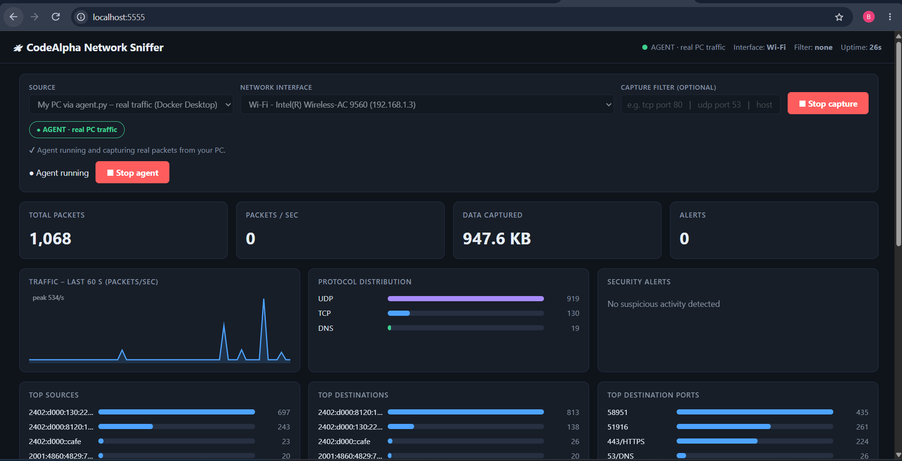
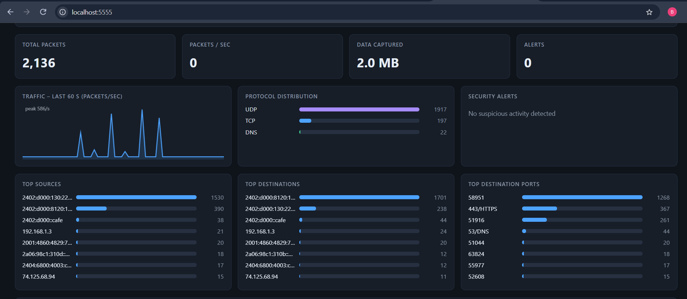
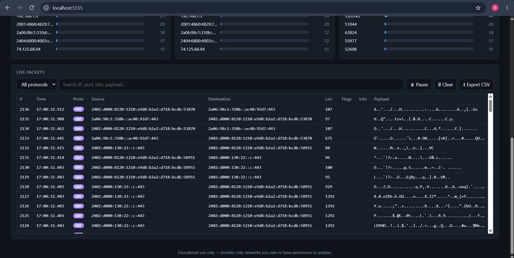

# 🔐 Basic Network Sniffer

**A Python packet sniffer built with Scapy, with a live web dashboard, to capture and analyse network traffic**

          

---

## 📌 Project Overview

This is my **Task 1 – Basic Network Sniffer** submission for the CodeAlpha Cyber Security Internship.

The project is a Python program that captures live network packets, decodes each protocol layer, and shows how data moves through a network. It has two parts:

- **`sniffer.py`** – a command-line sniffer (the core of Task 1).
- **Web dashboard** – a live Flask dashboard built on the same engine, with charts, filters and security alerts.

> **Note:** HTTPS traffic is encrypted, so only its metadata (IPs, ports, size) is visible. Plain HTTP and DNS can be read directly. This is a good demonstration of why encryption matters.

---

## 🎯 Objectives

- Capture network traffic packets using Python and `scapy`.
- Analyse the structure and content of captured packets.
- Understand how data flows through the network and the basics of protocols.
- Display source and destination IPs, protocols and payloads.
- Save captures to CSV and `.pcap` for later analysis in Wireshark.
- Present live traffic in a simple web dashboard.

---

## 🛡️ Purpose of the Tool

The sniffer gives me a hands-on way to learn and practise, for example:

- Reading packet headers and protocol layers
- Tracking DNS lookups and HTTP requests
- Spotting cleartext protocols and credentials
- Detecting simple port-scan behaviour
- Understanding what is (and is not) visible in encrypted traffic

⚠️ **Important:** Use this tool only on networks I own or have written permission to monitor. Capturing other people's traffic without consent may be illegal.

---

## 🏗️ How It Works

```
   Network interface (Wi-Fi / Ethernet)
               |
        scapy.sniff()  - captures raw frames
               |
        parse_packet() - walks the layers
   Ethernet > IP / IPv6 > TCP / UDP / ICMP / ARP
               |
   DNS / HTTP / TLS detection + payload preview
               |
     Terminal output   |   CSV / .pcap   |   Web dashboard
```



---

## ⚙️ Features

| 🧩 Feature | ⚙️ Description |
|---|---|
| 📡 Live capture | Any interface, with optional BPF filters such as `tcp port 80` |
| 🧱 Layer decoding | Ethernet → IPv4 / IPv6 → TCP / UDP / ICMP / ARP |
| 🔎 Packet details | Source/destination IP, ports with service names, TCP flags, length |
| 🌐 Application hints | DNS queries, HTTP request lines, TLS/HTTPS detection |
| 📦 Payload preview | Safe printable view of raw bytes (`-v`) |
| 📊 Capture summary | Protocol breakdown and top talkers |
| 💾 Export | CSV log and `.pcap` file (opens in Wireshark) |
| 📂 Offline analysis | Read and analyse an existing `.pcap` file |
| 🖥️ Web dashboard | Live table, traffic graph, protocol chart and alerts |
| 🚨 Security alerts | Port-scan heuristic, cleartext Telnet/FTP, credentials in plain HTTP |

---

# 🪜 Setup Procedure

## Step 1. Clone the repository

```bash
git clone https://github.com/<your-username>/CodeAlpha_NetworkSniffer.git
cd CodeAlpha_NetworkSniffer
```

## Step 2. Install the requirements

```bash
pip install -r requirements.txt
```

- **Windows:** install [Npcap](https://npcap.com/) and run the terminal as **Administrator**.
- **Linux / macOS:** run the sniffer with `sudo`.

## Step 3. Run the sniffer

```bash
sudo python3 sniffer.py                          # sniff until Ctrl+C
sudo python3 sniffer.py -c 50 -v                 # 50 packets, show payloads
sudo python3 sniffer.py -f "tcp port 80" -v      # only HTTP traffic
sudo python3 sniffer.py -f "udp port 53"         # only DNS
sudo python3 sniffer.py -i wlan0 --csv out.csv --pcap out.pcap
python3 sniffer.py -r out.pcap                   # analyse a saved capture
python3 sniffer.py --list-ifaces                 # list interfaces
```

| Option | Description |
|---|---|
| `-i, --iface` | Interface to sniff on |
| `-c, --count` | Number of packets (0 = until Ctrl+C) |
| `-f, --filter` | BPF filter expression |
| `-v, --verbose` | Show payload preview |
| `--csv FILE` | Log packets to a CSV file |
| `--pcap FILE` | Save raw packets to a `.pcap` file |
| `-r, --read FILE` | Read from a `.pcap` instead of live capture |
| `--list-ifaces` | List available interfaces and exit |

### Example output

```
[   1] 10:40:40.414  HTTP   192.168.1.5:51000 -> 93.184.216.34:80/HTTP  len=101  flags=PA  | GET /index.html HTTP/1.1
        payload: GET /index.html HTTP/1.1..Host: example.com....
[   2] 10:40:40.414  DNS    192.168.1.5:5353/mDNS -> 8.8.8.8:53/DNS  len=70  | Query: openai.com
[   3] 10:40:40.415  ICMP   192.168.1.5 -> 8.8.8.8  len=42  | Echo Request
[   4] 10:40:40.415  TCP    192.168.1.5:51001 -> 1.1.1.1:443/HTTPS  len=54  flags=S  | TLS/HTTPS (encrypted)
[   5] 10:40:40.416  ARP    192.168.1.5 -> 192.168.1.1  len=42  | who-has
```

---

# 🖥️ Web Dashboard

The dashboard runs at **http://localhost:5555** and shows live traffic from the same sniffer engine.


The top bar shows the capture source, interface, filter and uptime. The summary cards show total packets, packets per second, data captured and alerts.



The statistics panels show the protocol distribution, top sources, top destinations and top destination ports (for example `443/HTTPS` and `53/DNS`).



The live packet table lists every packet with time, protocol, source, destination, length, flags, info and payload. It can be searched, filtered by protocol, paused, cleared and exported to CSV.

## Run with Docker

**Linux** – capture directly from Docker:

```bash
docker compose --profile linux up --build   # starts capturing on the host network
docker compose --profile linux down         # stops it
```

**Windows / macOS (Docker Desktop)** – containers cannot see the PC's network cards, so real capture uses two small pieces on the host:

- **Watcher** (`agent.py --supervise`) – never captures; it only launches the agent when **Start agent** is pressed.
- **Agent** (`agent.py`) – captures real packets and streams them to the dashboard.

Prerequisites: Docker Desktop, [Npcap](https://npcap.com/), Python and `pip install scapy`.

One-time setup (PowerShell as Administrator, in the project folder):

```powershell
powershell -ExecutionPolicy Bypass -File windows\install-agent.ps1
```

Daily use:

1. Press **Start** on the project in Docker Desktop (or run `docker compose up -d`), then open http://localhost:5555.
2. Choose the source **My PC via agent.py** and press **Start agent**.
3. Pick the Wi-Fi or Ethernet interface and press **Start capture**.
4. **Stop capture** pauses capturing; **Stop agent** ends the agent.

Prefer no installation? Use `start.bat` / `stop.bat` to start and stop Docker and the watcher together.

## Run without Docker

```powershell
pip install -r requirements.txt
python dashboard.py        # run as Administrator, with Npcap installed
```

Choose **This machine – live capture**, pick the interface and press Start.

## Options (environment variables in `docker-compose.yml`)

| Variable | Meaning | Default |
|---|---|---|
| `AUTOSTART` | `agent` or `live` starts capturing automatically | off (`live` in the Linux profile) |
| `AUTOSTART_IFACE` | Interface used for auto-start | first usable interface |
| `AUTOSTART_FILTER` | Capture filter used for auto-start | none |
| `PORT` / `HOST` | Dashboard port / bind address | `5555` / `127.0.0.1` |

---

# 🔎 Verification

| ✅ Test | 🧾 Command / Action | 🎯 Result |
|---|---|---|
| 🧪 Offline analysis | `python3 sniffer.py -v -r test.pcap` | HTTP, DNS, ICMP, TCP/TLS and ARP decoded correctly |
| 📡 Live capture | Dashboard on Wi-Fi interface | 2,136 packets (2.0 MB) captured in one session |
| 📊 Protocol breakdown | Dashboard statistics | UDP, TCP and DNS counted and charted |
| 🔒 HTTPS traffic | Port `443` packets | Detected as encrypted, payload unreadable |
| 💾 Export | `--csv` / `--pcap` | Files written, `.pcap` opens in Wireshark |

---

# 🔒 Security Design

- The dashboard is bound to `127.0.0.1` only, and Docker publishes the port to localhost.
- Every state-changing request needs a custom `X-CodeAlpha` header, a local `Origin` and a local `Host`, which blocks CSRF and DNS-rebinding attacks from other websites.
- The dashboard can only *request* "start/stop agent". It cannot choose what program runs. The watcher only ever runs `agent.py` from the project folder.
- Captured data never leaves my computer.

---

# 💡 What I Learned

### 1. How packets are structured
Each packet is built from layers: Ethernet, IP, then TCP/UDP/ICMP, then the application data. Scapy lets me walk these layers one by one.

### 2. Protocol basics
- **TCP** – reliable and connection-based (flags: `S` SYN, `A` ACK, `F` FIN, `P` PSH, `R` RST)
- **UDP** – fast and connectionless (DNS, streaming, QUIC)
- **ICMP** – diagnostics such as `ping`
- **ARP** – maps IP addresses to MAC addresses on a LAN

### 3. Encryption in practice
HTTP is readable in plain text, while HTTPS payloads are encrypted. Most of my live traffic was UDP on port 443 (QUIC), which shows how much of today's traffic is encrypted.

### 4. Filtering and analysis
BPF filters narrow a capture to the traffic that matters, and exporting to `.pcap` allows deeper analysis in Wireshark.

### 5. Documentation
Writing down the usage, screenshots and security design is an important part of professional cybersecurity work.

---

# 🔐 Security & Ethical Use

This project is for **education and learning only**. All captures were made on my own network and device. I will only monitor networks that I own or have written permission to monitor.

---

# 🔗 Tools & Resources

- **Scapy:** https://scapy.net/
- **Npcap (Windows):** https://npcap.com/
- **Flask:** https://flask.palletsprojects.com/
- **Docker Desktop:** https://www.docker.com/products/docker-desktop/
- **Wireshark:** https://www.wireshark.org/

---

# 👤 Author

**Mubassir**
Cyber Security Intern, CodeAlpha

---

## 📌 Project Information

**Program Name:** Cyber Security Internship at CodeAlpha | **Task:** 1 – Basic Network Sniffer | **Repository:** CodeAlpha_NetworkSniffer
